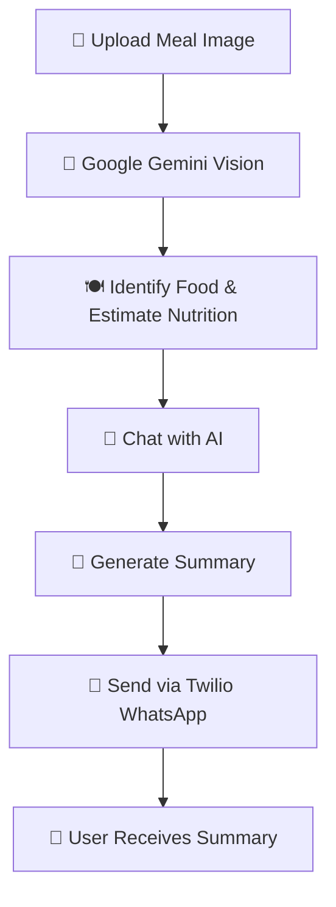

# **🥗 AI Vision Nutrition Chatbot**

An AI-powered nutrition chatbot that analyzes meal images, estimates nutrition, lets users chat about their meal, summarizes the conversation, and sends the summary through WhatsApp.
## ✨ Features

- 📸 Upload and analyze a meal image
- 🤖 Identify food items using AI vision
- 🔥 Estimate calories and macronutrients
- 🥩 Analyze protein, carbohydrates, and fat
- 💬 Chat with AI about the analyzed meal
- 📝 Generate a nutrition summary
- 📱 Send the summary to WhatsApp using Twilio
- 🌐 Interactive Streamlit web interface

## 🛠️ Technologies

- **Python** – Application development
- **Google Gemini API** – Vision analysis and AI chatbot
- **Streamlit** – Web interface
- **Twilio WhatsApp API** – WhatsApp messaging
- **Streamlit Community Cloud** – Deployment

## 📁 Project Structure

```text
AI-Vision-Nutrition-Chatbot/
│
├── app.py
├── requirements.txt
├── README.md
├── .gitignore
│
└── .streamlit/
    └── secrets.toml
```


## 🔄 Workflow


## 🚀 Setup
### 1. Clone the repository
```bash
git clone https://github.com/YOUR_USERNAME/AI-Vision-Nutrition-Chatbot.git
cd AI-Vision-Nutrition-Chatbot
```
### 2. Install dependencies
```bash
pip install -r requirements.txt
```
### 3. Configure API keys
- Create the following file:
```bash
.streamlit/secrets.toml
```
- Add your credentials:
```bash
GEMINI_API_KEY = "your_gemini_api_key"
TWILIO_ACCOUNT_SID = "your_account_sid"
TWILIO_AUTH_TOKEN = "your_auth_token"
TWILIO_CONTENT_SID = "your_content_sid"
```
### 4. Run the application:
```bash
streamlit run app.py
```
The application will open in your browser.

### 5. Deploy on Streamlit Community Cloud
- Push your project to GitHub.
- Open Streamlit Community Cloud.
- Select your GitHub repository.
- Select app.py as the main file.
- Add your API keys under Settings → Secrets.
- Deploy the application.
### 6. Security
Do not upload your .streamlit/secrets.toml file to GitHub.
Add the following to .gitignore:
```bash
.streamlit/secrets.toml
```
**Note:** Replace `YOUR_USERNAME` with your actual GitHub username, but keep the API key values as placeholders in the README. Never put your real API keys in the README.
## ☁️ Deployment
The application can be deployed using Streamlit Community Cloud.

Add the same API credentials under the application's Secrets settings.

## ⚠️ Disclaimer
Nutrition values are AI-generated estimates and may not be completely accurate. They depend on image quality, portion size, ingredients, and preparation methods.

This application is for informational purposes only and is not a substitute for professional medical or nutrition advice.

## 🔮 Future Improvements
- 📊 Daily and weekly nutrition tracking
- 🎯 Personalized calorie and macro goals
- 🥗 Meal recommendations
- 📈 Nutrition progress charts
- 🗂️ User meal history

## 👨‍💻 Author
**G NIKHIL SAI**
# Built with Python, Google Gemini, Streamlit, and Twilio. 🥗🤖
